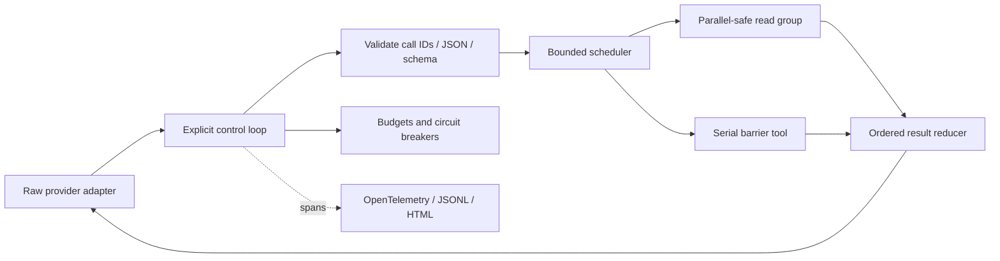
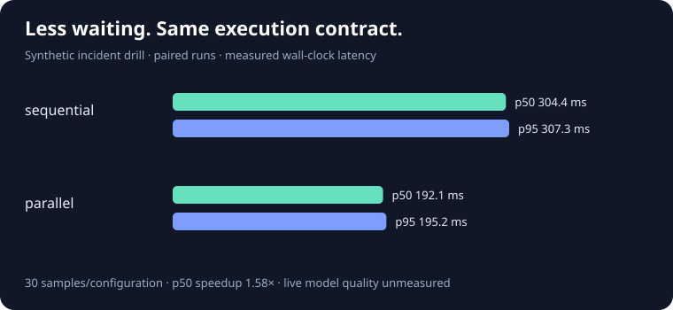

# Agent Systems · Tool Loop

[](https://github.com/sn41lz/agent-systems-tool-loop/actions/workflows/ci.yml)

**An agent can propose a tool call. It does not get to decide whether that call is safe to execute.**

This Python runtime makes that boundary inspectable: a raw model adapter proposes work; an explicit control loop validates arguments, schedules independent tools, returns recoverable errors, and stops when a budget or circuit breaker trips. No LangChain, LlamaIndex, or Agents SDK.

The included incident drill investigates a failing checkout canary. It gathers deployment, topology, and cohort metrics concurrently, rejects an invalid log query, repairs it on the next model turn, survives a transient telemetry failure, and produces a cited diagnosis with a human verification plan. A standalone HTML report exposes exactly what ran and when.

**The default drill uses synthetic evidence and scripted model replies.** It demonstrates real runtime execution, concurrency, validation and recovery; it does not measure model reasoning quality. An optional raw OpenAI Responses adapter can run the same read-only tools with a live model.

## Run it

With Docker and Compose v2 installed, from this repository:

```sh
make demo
```

Open `artifacts/demo/report.html`. No API key or telemetry collector is needed. The command builds the pinned image, runs with network disabled, and removes the container. The first build downloads dependencies.

Other complete review paths:

```sh
make test                       # behavioral, fault-injection, SDK-contract and artifact tests
make benchmark RUNS=30          # paired sequential/parallel comparison + raw results
```

Without Docker, use Python 3.12+ and Make:

```sh
make local                      # isolated setup + demo + tests
make local-benchmark RUNS=30
```

The setup uses exact, SHA-256-checked dependency locks. See [development and container details](docs/development.md). A committed [example report](docs/examples/report.html), [run result](docs/examples/result.json), and [OTel trace](docs/examples/traces.jsonl) are available to inspect without running anything; download the HTML to open it locally.

## What makes the loop interesting

| Boundary | Implemented behavior |
| --- | --- |
| Untrusted proposals | JSON Schema 2020-12 validation before dispatch; unknown tools, duplicate keys, invalid Unicode, non-finite numbers, excessive nesting and argument size are rejected. |
| Concurrency | Explicit `parallel_safe` opt-in, bounded fan-out, and serial barriers for all other tools. Reduction always follows proposal order. |
| Recovery | Structured errors are fed back to the model for correction. Automatic tool retries require both `retry_safe=True` and an explicit `ToolTransientError`. Each attempt receives fresh arguments. |
| Cancellation | Per-call timeouts and a run deadline cancel and drain cooperative tasks. Completed, cancelled and never-started outcomes remain visible in proposal order. |
| Circuit breakers | Turn, proposed-call, observed-token, repeated-batch and wall-time limits; per-model attempt budgets; bounded arguments and outputs. |
| Traceability | Real OTel spans for runs, every model request, each logical tool call and every handler attempt. Parent IDs preserve concurrent context. |
| Provider protocol | Raw Responses API; no hidden SDK retries; incomplete responses fail closed; all provider output items, including encrypted reasoning, are replayed. |
| Evidence | Local JSONL traces, structured run results, portable HTML reports, and paired benchmark samples with environment/configuration/source hashes. |

## Architecture



Read [the runtime](src/tool_loop/runtime.py) for the mechanics, [the provider adapter](src/tool_loop/providers.py) for the wire boundary, and [the incident scenario](src/tool_loop/scenarios.py) for the complete drill. [Architecture and decisions](docs/architecture.md) explains the invariants and tradeoffs.

## Measured baseline versus optimized execution

The [reference benchmark](benchmarks/reference/summary.json) compares the **same incident protocol** with `max_parallel=1` and `max_parallel=4`. It runs 30 measured pairs, alternates configuration order, discards two warmup pairs, and verifies evidence IDs, schema rejection, retry behavior, turn count and terminal status in every measured run.



| Configuration | Samples | Protocol checks | p50 | p95 |
| --- | ---: | ---: | ---: | ---: |
| sequential | 30 | 100% | 304.36 ms | 307.32 ms |
| parallel | 30 | 100% | 192.13 ms | 195.19 ms |

These are measured wall-clock times for synthetic, in-memory tools on the recorded host. They include tracing and runtime overhead. They are not live-provider latency or model-quality results. Timing varies by machine and workload; CI checks correctness rather than imposing a brittle speed threshold. p50/p95 use linear interpolation at `(n−1)q`.

Both configurations report 2,780 synthetic input tokens, 650 synthetic output tokens, and 768 cached input tokens per run. Actual model API calls and actual model API cost are **zero**. The example rate card is deliberately fictional: USD 1 / 4 / 0.25 per million input / output / cached tokens, projecting **$4.804 per 1,000 runs**. Live-model quality, live latency, real cost and streaming TTFT remain unmeasured. This implementation uses non-streaming model responses.

Inspect [every measured sample](benchmarks/reference/runs.jsonl), the [method and source hashes](benchmarks/reference/summary.json), or reproduce with `make benchmark RUNS=30`.

## Failure modes and architectural tradeoffs

| Failure or limit | Runtime behavior / evidence | Remaining boundary |
| --- | --- | --- |
| Invalid or invented tool call | Structured error; handler is never invoked. The incident drill repairs a rejected schema. | A real model may fail to correct it; budgets still apply. |
| Repeated work with fresh call IDs | Canonical argument fingerprint stops consecutive identical batches. Try `.venv/bin/python -m tool_loop demo --scenario loop` after local setup. | Longer alternating cycles are bounded by turns/calls rather than detected semantically. |
| Duplicate call ID | Rejects the whole batch before execution. | This is protocol protection, not persistent idempotency across runs. |
| Transient failure | Retries only explicitly safe handlers; individual attempts are traced. | Retry safety is an application contract, not something inferred by the model. |
| Timeout or cancellation | Cancels cooperative tasks; preserves partial outcomes; does not automatically retry the ambiguous effect. | Async cancellation cannot stop blocking or cancellation-suppressing code, or undo external effects. |
| Observed token budget exceeded | Accounts for the response, stops tools and further requests; caps requested output tokens. | Prompt usage and billed timeout/retry attempts may be unknown until afterward. This is **not a hard spend cap**. |
| Tool output too large or not JSON | Returns an error asking the model to narrow the query; never truncates JSON mid-object. | The trusted handler may allocate memory before the output limit is checked. |
| Tool content contains instructions | Developer instructions mark tool data as untrusted; execution stays limited to the registered tools. | Prompt-injection resistance and answer truth require their own live-model evaluations. |
| Unsafe operations need ordering | Non-parallel tools act as barriers around read groups. | A caller that incorrectly marks a tool parallel/retry safe can violate its own contract. |

Tools are trusted, cooperative async functions. This project is **not an isolation boundary for arbitrary generated Python**. It also does not implement distributed execution, durable recovery, exactly-once effects, context compaction, or cross-run memory. See [verification boundaries](docs/architecture.md#verification-boundaries).

## Optional live model

Choose a model ID available to your own OpenAI project. The live path can make billable requests; the synthetic tools remain read-only.

```sh
export OPENAI_API_KEY='your key'
export OPENAI_MODEL='your chosen model ID'
make live
```

Or, after `make setup`:

```sh
.venv/bin/python -m tool_loop live --model "$OPENAI_MODEL" --output artifacts/live
```

Model and provider IDs, token usage and outcome metadata are recorded. Prices are unknown by default; supply all three `--input-rate`, `--output-rate`, `--cached-rate` values (USD per million tokens) and `--price-label` to calculate a caller-supplied estimate. Verify current prices yourself. Estimates cover reported usage; unknown billed attempts and non-token charges are excluded.

Traces omit prompts, tool arguments/results, reasoning payloads and exception messages. Live result/report content is omitted by default; `--include-content` explicitly enables it. The final response is still printed to the invoking terminal. Artifacts are local and traces/results/reports use private file permissions; review them before sharing. The API uses `store=False` and preserves returned reasoning items for the next request, as required by the [official function-calling guidance](https://developers.openai.com/api/docs/guides/function-calling). This setting is not a claim about organization-level retention policy.

## Extend it

Implement `Provider.generate(ModelRequest) -> ModelReply` to change models, or register an async `Tool` with a schema and explicit execution policy. [The minimal example](examples/custom_tool.py) runs a custom tool without credentials. `Telemetry` is scoped per instance, so independent agents can be embedded without changing a host application's global tracer provider.

The [production checklist](PRODUCTION_CHECKLIST.md) links implemented requirements to evidence. CI runs lint, type checking, behavioral tests, packaging, the offline demo and benchmark on Python 3.12–3.14, plus actual Docker execution. No provider credentials are needed in CI.
